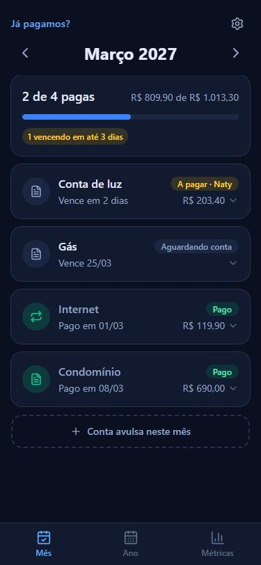
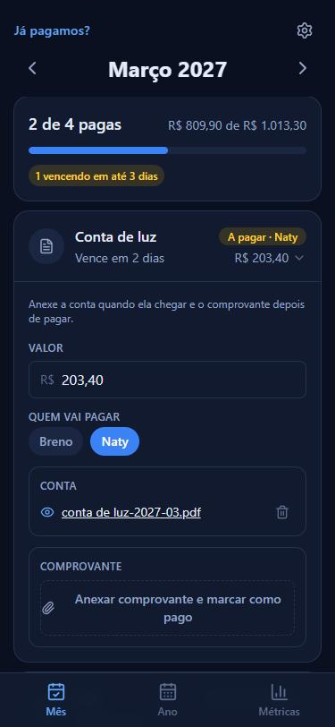
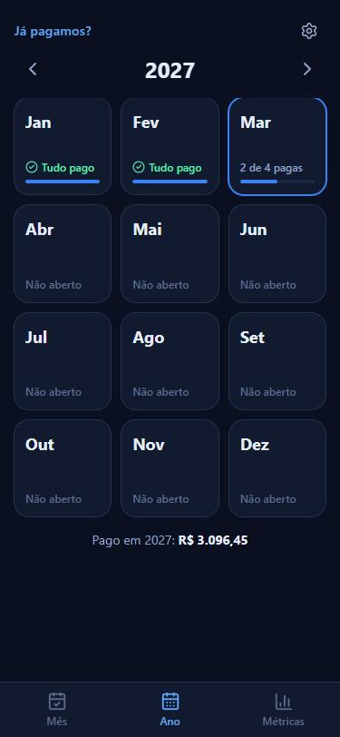
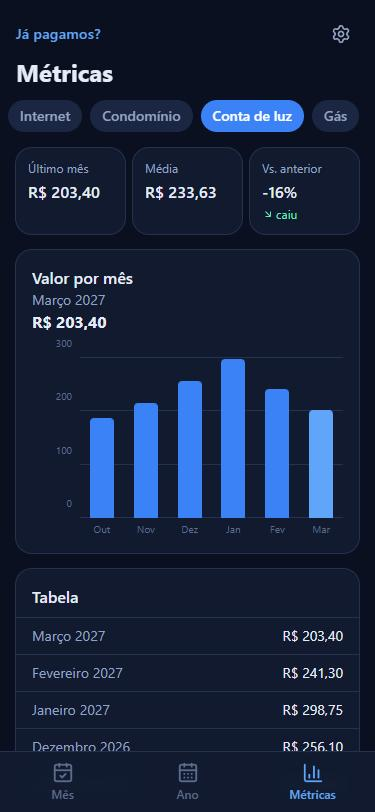
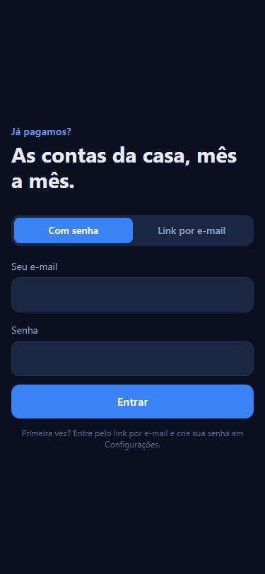
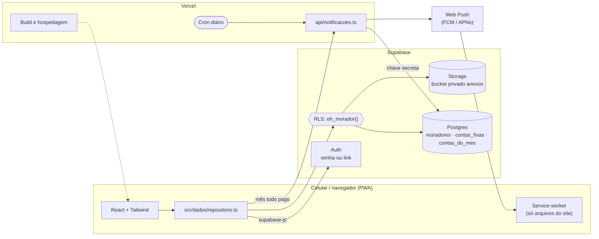

<p align="center">
  
</p>

<h1 align="center">Já pagamos?</h1>

<p align="center">
  As contas da casa, mês a mês: checklist, conta e comprovante no mesmo lugar.<br />
  App web instalável (PWA) feito para resolver um problema real de casa.
</p>

<p align="center">
  
  
  
  
  
  
</p>

---

## O problema

Em casa, as contas chegam de jeitos diferentes (e-mail, app, site, débito automático) e em datas
diferentes. Eu e minha namorada nunca sabíamos direito **o que já tinha sido pago**, **quem ia pagar
o quê** e **onde estava o comprovante**.

O **Já pagamos?** gera sozinho a checklist de cada mês a partir das contas fixas da casa. Cada conta
guarda o PDF (ou foto) da conta e o comprovante, e o status muda conforme os anexos chegam.

## Telas

| Mês | Conta aberta | Ano | Métricas | Login |
| :---: | :---: | :---: | :---: | :---: |
|  |  |  |  |  |

<sub>Prints com dados fictícios.</sub>

## Funcionalidades

- **Checklist automática do mês** gerada a partir das contas fixas (nome, dia de vencimento e tipo).
- **Status pelos anexos:** sem conta → _aguardando conta_; com a conta → _a pagar_; com o comprovante
  → _pago_. Débito automático pula a primeira etapa e já começa como _mandar Pix_.
- **Quem vai pagar:** cada conta pode ter um responsável.
- **Código para pagar com um toque:** linha digitável, Pix copia e cola ou chave Pix com botão
  **Copiar**, e valor copiável. Contas fixas podem ter valor e chave Pix que entram sozinhos todo mês.
- **Anexos em PDF ou foto** guardados num bucket privado, abertos por link temporário.
- **Data de pagamento editável**, valor da conta e **contas avulsas** só de um mês (IPTU, consulta...).
- **Destaques de prazo:** atrasadas em vermelho e as que vencem em até 3 dias no resumo.
- **Visão do ano** em calendário, com a situação de cada mês.
- **Métricas por conta:** último mês, média, variação e gráfico de colunas, com tabela.
- **Dois moradores, mesmos dados:** login por senha ou link no e-mail, acesso liberado por e-mail.
- **PWA:** instalável no celular, com ícone próprio e tema escuro.
- **Notificações push:** lembrete no começo do mês, 5 dias antes, 1 dia antes e no dia do vencimento
  (só se ainda não tiver comprovante), e uma comemoração quando o mês inteiro fica pago.

## Arquitetura



O app em si não tem backend próprio: o front fala direto com o Supabase, e **quem protege os dados é
o Postgres**, com Row Level Security. A única função de servidor é a das notificações, que roda na
Vercel uma vez por dia (e quando o mês fecha) e usa a chave secreta do Supabase. Toda a leitura e escrita passa por um único módulo
([`src/dados/repositorio.ts`](src/dados/repositorio.ts)), que converte o formato do banco
(`snake_case`) para o do app e concentra as regras de sincronização.

### Modelo de dados

| Tabela | Para quê |
| --- | --- |
| `moradores` | E-mail e nome de quem mora na casa. Estar aqui é o que libera o acesso. |
| `contas_fixas` | Modelo das contas que se repetem (nome, dia, tipo, valor e código fixos). Desativadas em vez de apagadas. |
| `contas_do_mes` | Cada linha da checklist: vencimento, valor, código para pagar, responsável, anexos (`jsonb`) e data de pagamento. |

O esquema completo, com as políticas, está em [`supabase/migrations`](supabase/migrations).

## Decisões de projeto

- **O status é derivado, não armazenado.** Ele sai dos anexos ([`src/lib/status.ts`](src/lib/status.ts)).
  Não existe um "marcar como pago" que possa ficar sem comprovante, nem um status que contradiz os
  arquivos.
- **Acesso por e-mail com RLS.** Uma função `eh_morador()` (`security definer`) confere se o e-mail do
  JWT está em `moradores`. A mesma regra vale para as tabelas e para o bucket de arquivos. Alguém que
  crie conta sem estar na lista vê tudo vazio, e o app mostra "acesso não liberado".
- **Meses gerados sob demanda e idempotentes.** Ao abrir um mês, o app cria as contas fixas que faltam.
  Um `unique (mes, conta_fixa_id)` com `upsert ... ignoreDuplicates` evita duplicar quando os dois abrem
  o mês ao mesmo tempo. Meses passados ficam congelados; o atual e os futuros acompanham as mudanças nas
  contas fixas.
- **Datas como texto (`YYYY-MM-DD`).** Vencimento é um dia do calendário, não um instante. Guardar e
  comparar como texto evita o clássico "venceu um dia antes" por causa de fuso horário.
- **Login por senha além do link mágico.** O e-mail grátis do Supabase manda poucos links por hora, e
  no iPhone o app instalado não compartilha sessão com o Safari. A senha resolve os dois. O link fica
  para o primeiro acesso.
- **Service worker conservador.** Ele só guarda os arquivos do próprio site (rede primeiro para a
  página, cache primeiro para os arquivos com hash). Dados, login e anexos nunca passam pelo cache, para
  ninguém ver uma conta "pendente" que já foi paga.
- **Notificações sem aviso repetido.** A regra do que avisar é uma função pura (`montarAvisosDoDia`),
  testável sem banco. Cada aviso mandado vira uma chave em `avisos_enviados`
  (`vence:1:2026-11:<conta>`, `tudo-pago:2026-11`), então rodar o cron duas vezes não manda nada em
  dobro. Contas de um mês que ninguém abriu ainda entram como pendentes, para o aviso de 5 dias
  funcionar na virada do mês. O "hoje" é calculado no fuso de São Paulo, já que o servidor roda em UTC.
- **Tema com tokens.** As cores ficam em `@theme` no CSS (`bg-superficie`, `text-suave`, `bg-destaque`...),
  então trocar a paleta é mexer num lugar só. O azul das colunas foi validado contra o fundo escuro
  (contraste mínimo de 3:1).

## Rodando localmente

Pré-requisitos: Node.js 22 (LTS) ou mais recente e um projeto (grátis) no [Supabase](https://supabase.com).

```bash
git clone https://github.com/ODBreno/ja_pagou.git
cd ja_pagou
npm install
```

1. No **SQL Editor** do Supabase, rode os arquivos de [`supabase/migrations`](supabase/migrations)
   em ordem.
2. Rode também [`supabase/seed.example.sql`](supabase/seed.example.sql), trocando os e-mails pelos
   de quem vai usar.
3. Em **Authentication → Users → Add user**, crie os usuários com senha e marque _Auto Confirm User_.
4. Copie `.env.example` para `.env.local` e preencha com a **Project URL** e a **Publishable key**.
5. Suba o app:

```bash
npm run dev
```

| Script | O que faz |
| --- | --- |
| `npm run dev` | Servidor de desenvolvimento (Vite) |
| `npm run build` | Checagem de tipos e build de produção |
| `npm run lint` | Lint com oxlint |
| `npm run preview` | Serve o build localmente |

## Estrutura

```
src/
├── components/   telas (TelaDoMes, TelaAno, TelaMetricas, Configuracoes, TelaLogin) e peças
├── dados/        cliente do Supabase e repositório (único ponto de acesso a dados)
├── lib/          regras puras: status, datas, dinheiro
└── tipos.ts      modelo do domínio
supabase/         esquema do banco, políticas de acesso e seed de exemplo
public/           ícones, manifest e service worker do PWA
```

## Como o projeto é versionado

Commits em [Conventional Commits](https://www.conventionalcommits.org/pt-br/), em português, validados
por **commitlint** num hook do **husky**. Antes de cada commit roda o lint. O deploy na Vercel é
automático a cada push na `main`.

## Próximos passos

- [x] Código do boleto / Pix copia-e-cola com botão de copiar
- [ ] Testes (Vitest) e CI no GitHub Actions
- [ ] Atualização em tempo real entre os aparelhos (Supabase Realtime)
- [x] Lembrete de contas perto do vencimento
- [ ] Receber o PDF direto do "Compartilhar" do celular (Web Share Target)
